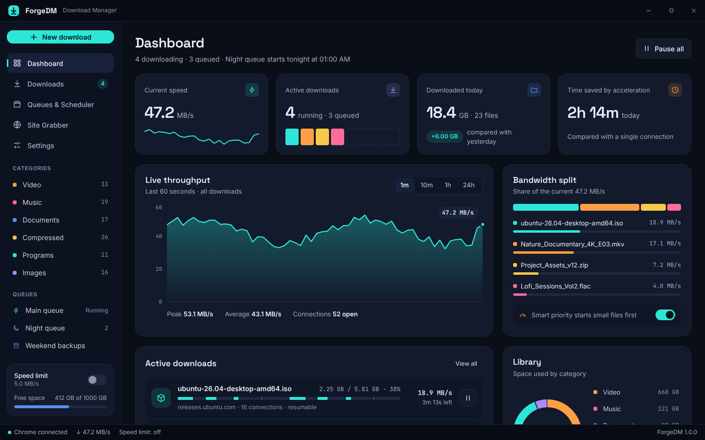
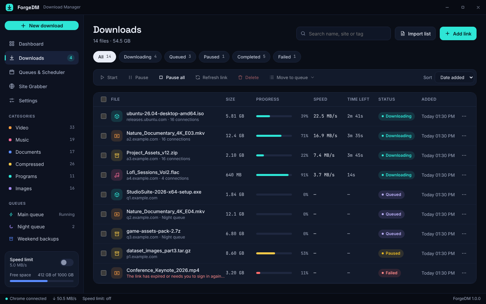
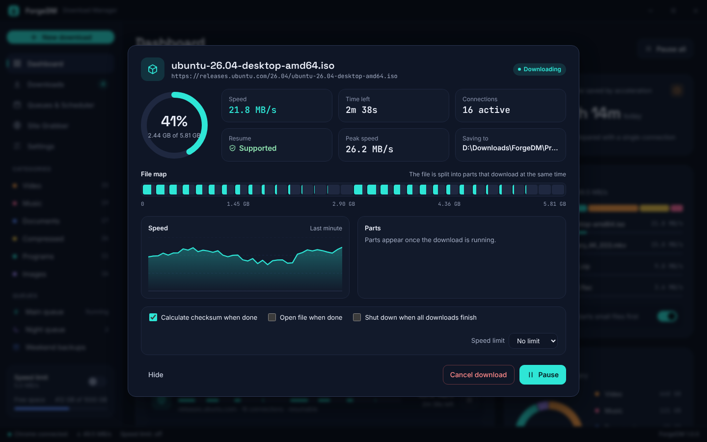
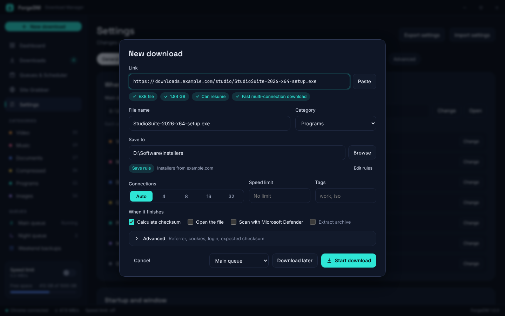
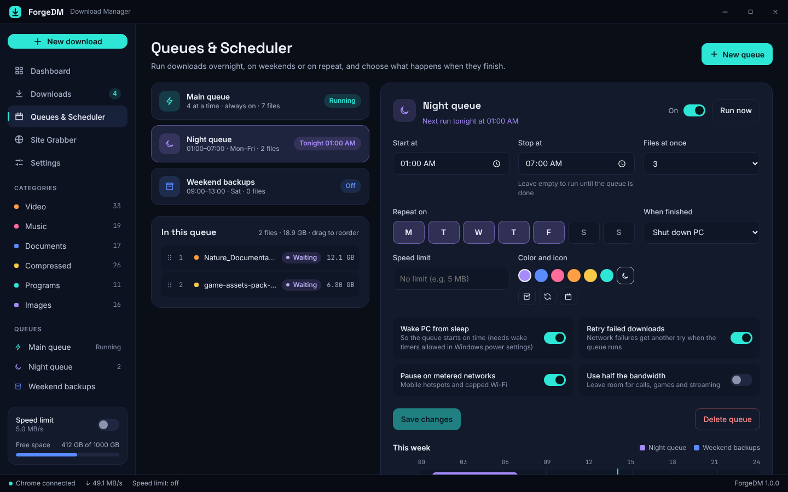

# ForgeDM

A fast, good-looking download manager for Windows. ForgeDM splits each download
into parts that download at the same time, picks up where it stopped after a
crash or restart, catches downloads and videos from your browser, and runs
queues on a schedule. It has the features people know from Internet Download
Manager, plus several extras.



## Features

**Downloading**
- Multi-connection downloads with dynamic splitting: when one part finishes,
  its connection takes over half of the biggest remaining part, so every
  connection stays busy until the end
- Pause and resume, also after closing ForgeDM or a crash
- Automatic retries, reconnects when a connection goes quiet, and refreshing
  expired links without losing progress
- Video streams (HLS `.m3u8`), including AES-128 encrypted ones, saved as one file
- Speed limits: for everything, per queue, or per download
- Proxy support (Windows settings, none, or custom)

**Organizing**
- Categories with their own folders (Video, Music, Documents, Compressed,
  Programs, Images)
- Save rules: "if the site is X and the type is Programs, save to D:\Installers
  and tag #work". Match by type, extension, site, size, name or link
- Tags, duplicate detection, search, sorting and filters
- Import a list of links from a text file

**Browser integration** (Chrome, Edge, Brave, Opera, Vivaldi, Firefox)
- Catches download links with the page's cookies and referrer
- "Download with ForgeDM" and "Download all links with ForgeDM" right-click menus
- A "Download this video" button on web video players, with quality choices
- Hold Alt while clicking to let the browser download instead
- The extension only talks to ForgeDM on your PC, after you approve it once

**Scheduling**
- Queues with start and stop times and days of the week
- Wake the PC from sleep to start a queue
- Shut down, sleep, hibernate or close ForgeDM when a queue finishes
- Pause on metered networks, use half the bandwidth, retry failed downloads

**Site Grabber**
- Scan a page, its linked pages or a whole site for images, videos,
  documents and archives, with sizes, and download the ones you pick
- Save scans as projects and sync them weekly (new files only)

**After downloading**
- SHA-256 (or MD5/SHA-1/SHA-512) checksums, compared with the value you paste
- Scan with Microsoft Defender
- Extract zip, 7z, rar and tar archives
- Open the file, Windows notifications

**Extras**
- Dashboard with live speed graphs, bandwidth split, library chart and
  7-day history, plus "time saved by acceleration"
- Clipboard watching: copy a download link and ForgeDM offers to download it
- A floating drop target: drag links onto it to download
- System tray menu, start with Windows, keeps the PC awake while downloading
- Themes (Midnight, Graphite, Daylight, Match Windows) and accent colors
- Export and import settings

| | |
|---|---|
|  |  |
|  |  |

## Install

1. Download `ForgeDM-Setup-<version>.exe` from the
   [latest release](../../releases/latest), or the `ForgeDM-windows` artifact of
   the latest [build](../../actions).
2. Run it and click through the setup. Because ForgeDM isn't code-signed yet,
   Windows SmartScreen may warn you first: click **More info → Run anyway**.

Setup installs ForgeDM for your Windows account in
`%LOCALAPPDATA%\Programs\ForgeDM`, so it doesn't need administrator rights. It
adds ForgeDM to the Start menu and to **Settings → Apps** (where you uninstall
it), and lets you pick a desktop shortcut and starting with Windows. Running a
newer setup updates ForgeDM in place and keeps your downloads and settings; if
ForgeDM is open, setup asks it to save and close first. Windows 10 and 11
already include the WebView2 runtime ForgeDM needs; if it's missing, setup
installs it.

Prefer no installer? `ForgeDM-portable.zip` has the same app as a single
`ForgeDM.exe` you can run from anywhere.

### Connect your browser

In ForgeDM open **Settings → Browser integration → Connect a browser** and
follow the steps. In short:

- **Chrome, Edge, Brave, Opera, Vivaldi:** open the extensions page, turn on
  Developer mode, click **Load unpacked** and choose the `chrome` folder that
  ForgeDM opens for you. Then click the ForgeDM toolbar icon → **Connect**, and
  click **Allow** in ForgeDM.
- **Firefox:** `about:debugging` → This Firefox → Load Temporary Add-on → pick
  `manifest.json` in the `firefox` folder.

Publishing the extension to the Chrome Web Store, Edge Add-ons and Firefox
Add-ons would make this a one-click install.

## Build from source

Requirements: Go 1.26+, Node.js 20+, and the Wails CLI.

```sh
go install github.com/wailsapp/wails/v2/cmd/wails@v2.17.1
wails build -platform windows/amd64 -trimpath -ldflags "-s -w"
```

The app is in `build/bin/ForgeDM.exe`. Add `-nsis` (with NSIS installed) to
also build the installer, `build/bin/ForgeDM-Setup-<version>.exe`; its script is
`build/windows/installer/project.nsi`. You can build both from Linux or macOS
too. Pushing a tag like `v1.0.0` makes GitHub Actions build and publish a release.

Run the tests:

```sh
go test -race ./internal/...
```

Work on the UI in a browser with sample data:

```sh
cd frontend && npm install && npm run dev
```

## How it's built

- **Go** for everything that touches the network and disk (`internal/`):
  - `engine` — segmented downloader, resume, HLS, speed limits
  - `app` — ties everything together and is what the UI calls
  - `rules`, `config` — save rules, settings, queues
  - `grabber` — Site Grabber crawler
  - `postproc` — checksums and archive extraction
  - `api` — the local connection the browser extension uses
  - `platform` — Windows integration: sparse files, wake timers, Defender,
    proxy, startup, power actions
- **Wails v2** for the window, using the WebView2 that comes with Windows, so
  the app is about 15 MB.
- **React + TypeScript** for the interface (`frontend/`).
- **Browser extension** in plain JavaScript (`extension/`), Manifest V3.

Your settings and download list are in `%APPDATA%\ForgeDM`.

## Notes

ForgeDM doesn't download copy-protected (DRM) streams, and it doesn't include
special support for sites whose terms forbid downloading.
